# KN01: Virtualisierung & erste automatisierte VM

## A) Repository & Multipass-Test

### A1) Repository

Für alle Abgaben habe ich dieses Repo erstellt. Pro KN gibt es einen Ordner (`KN01/`, `KN02/`, ...). Code-Dateien liegen immer als eigene Datei im Ordner, Screenshots kommen in `img/`.

### A2) Multipass-Test

- Windows-Edition: Windows 11 Pro
- Multipass-Version: 1.17.0
- Backend (`local.driver`): `hcs`

`hcs` steht für "Host Compute Service". Das ist die Schnittstelle von Hyper-V, über die Multipass ab Version 1.17 die VMs steuert. Dahinter läuft also Hyper-V.

Befehle, die ich ausgeführt habe:

```powershell
multipass version
multipass get local.driver
(Get-CimInstance Win32_OperatingSystem).Caption
multipass launch --name smoke -c 1 -m 1G -d 5G 26.04
multipass list
multipass exec smoke -- lsb_release -a
multipass delete --purge smoke
```

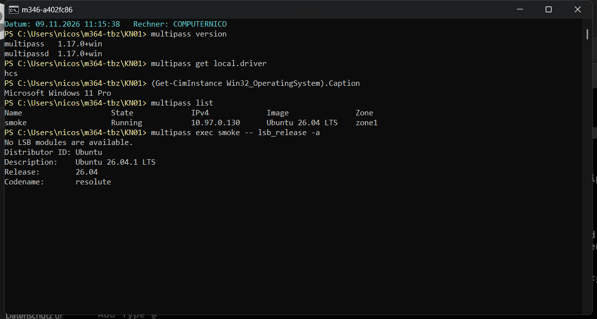

Die Installation hat beim ersten Mal nicht geklappt, weil `winget` auf meinem Laptop nicht vorhanden ist. Ich habe dann den Installer direkt von der Multipass-Seite geholt. Nach der Installation lief der Multipass-Dienst noch nicht (`multipass_root_cert.pem` fehlte), nach einem Neustart vom Laptop ging alles.

## B) Hypervisor-Experiment

Teil B habe ich alleine gemacht, nicht in einer Gruppe. Darum habe ich nur mein eigenes Backend getestet. Die anderen Backends habe ich nur mit der Theorie eingeordnet.

### Backends

| Backend | Betriebssystem | Vermutung | Begründung | Getestet |
|---|---|---|---|---|
| hcs (Hyper-V) | Windows 11 Pro (mein Laptop) | Typ 1 | Hyper-V ist fest in Windows eingebaut und läuft direkt auf der Hardware. Windows selber läuft eigentlich auch nur als eine Art VM darüber. | ja |
| virtualbox | Windows Home | Typ 2 | VirtualBox ist ein normales Programm, das man auf Windows installiert. Es läuft also auf dem Betriebssystem und nicht direkt auf der Hardware. | nein |
| qemu | Linux / macOS | nicht eindeutig | QEMU selber läuft als Programm (eher Typ 2). Unter Linux nutzt es aber KVM, das im Kernel steckt und direkt mit der Hardware arbeitet (eher Typ 1). | nein |

### Host-Ressourcen

Mein Laptop hat 22 logische Prozessoren und 63.5 GB RAM.

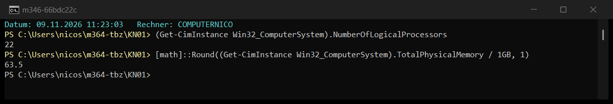

### Test-VM mit 4 CPUs und 4 GB RAM

```powershell
multipass launch --name test -c 4 -m 4G 26.04
multipass exec test -- lscpu
multipass exec test -- free -h
```

Die VM sieht genau 4 CPUs und ca. 4 GB RAM. Bei `lscpu` sieht man auch "Hypervisor vendor: Microsoft", also läuft sie wirklich unter Hyper-V. Swap hat die VM keinen (0B).

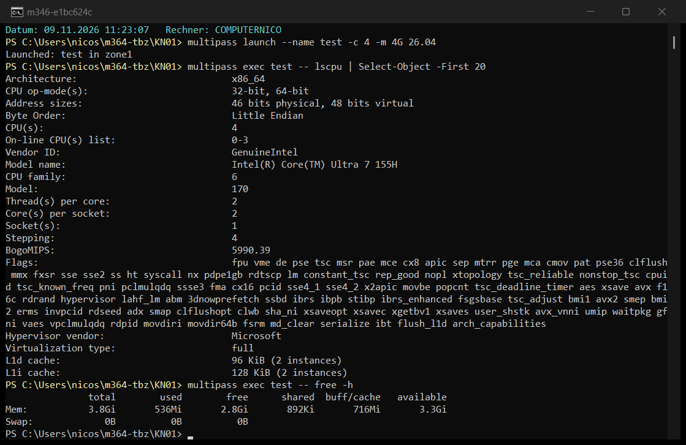

### Mehr CPUs als vorhanden

22 logische Prozessoren + 4 = 26.

```powershell
multipass launch --name cpu-test -c 26 26.04
```

Ergebnis: abgelehnt mit `create_compute_system failed with 0x80004005`. Die VM wurde gar nicht erstellt.

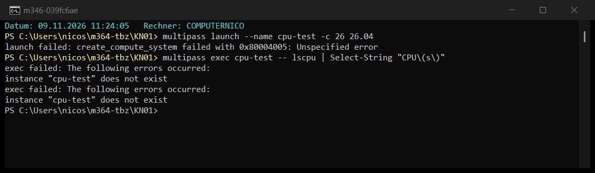

### Mehr RAM als vorhanden

63.5 GB + 8 GB, aufgerundet auf 72 GB.

```powershell
multipass launch --name ram-test -m 72G 26.04
```

Ergebnis: abgelehnt mit `The paging file is too small for this operation to complete`.

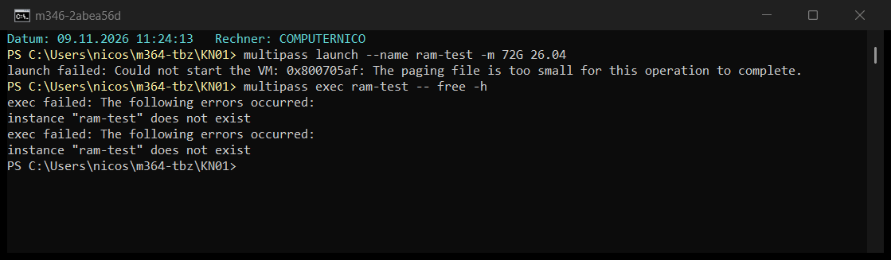

Am Schluss habe ich alles gelöscht: `multipass delete --purge test` (cpu-test und ram-test gab es gar nicht, weil sie nicht erstellt wurden).

### Erklärung

Bei mir hat Hyper-V beide Zuweisungen abgelehnt. Meine Vermutung (Typ 1) hat sich damit bestätigt.

- **CPU:** Eine virtuelle CPU ist für den Host eigentlich nur ein Thread, der in Zeitscheiben auf einem echten Kern läuft. Theoretisch könnte man also mehr vCPUs geben, als es Kerne gibt. Hyper-V lässt das aber bei **einer einzelnen** VM nicht zu: Eine VM darf höchstens so viele vCPUs haben, wie der Host logische Prozessoren hat. Mehr würde für die VM auch nichts bringen, weil sowieso nie mehr als 22 Threads gleichzeitig laufen können. Über **mehrere** VMs zusammen geht Overcommitment schon (z. B. 10 VMs mit je 4 vCPUs = 40 vCPUs auf 22 Prozessoren). Dort verteilt Hyper-V die Zeitscheiben auf die VMs.
- **RAM:** Hyper-V reserviert den RAM einer VM beim Start fest. Er wird nicht vom Host-Betriebssystem in den Swap ausgelagert, wie das bei einem Typ-2-Hypervisor wie VirtualBox passieren kann. Windows kann nur so viel Speicher vergeben, wie RAM plus Auslagerungsdatei (Pagefile) zusammen gross sind. 72 GB war mehr, als möglich ist, darum kam der Fehler "paging file is too small". Der Fehler ist gut so: Wenn es geklappt hätte und die VM den RAM wirklich bräuchte, müsste ständig auf die Disk ausgelagert werden, und alles würde extrem langsam (Thrashing).

Ein Typ-2-Hypervisor läuft als normales Programm auf dem Betriebssystem. Dort erzeugt das Host-OS mit seinem Scheduler und dem Swap die "Illusion" von mehr Ressourcen. Darum klappt Overcommitment bei Typ 2 eher. Hyper-V arbeitet direkt auf der Hardware und prüft die Grenzen beim Start der VM.

Weil ich alleine gearbeitet habe, konnte ich nicht vergleichen, ob sich die Backends gleich verhalten. Meine Erwartung: Mit VirtualBox (Typ 2) würde die Zuweisung eher klappen, oder es käme nur eine Warnung. Die VM wäre dann aber unter Last sehr langsam.

## C) Erste automatisierte VM mit cloud-init

### C1) Basis-Konfiguration

Datei: [cloud-init-basis.yaml](cloud-init-basis.yaml)

```powershell
multipass launch --name kn01 --cloud-init cloud-init-basis.yaml 26.04
```

**Pakete:** `tree` ist installiert, `neofetch` aber **nicht**. `cloud-init status` zeigt `error`.

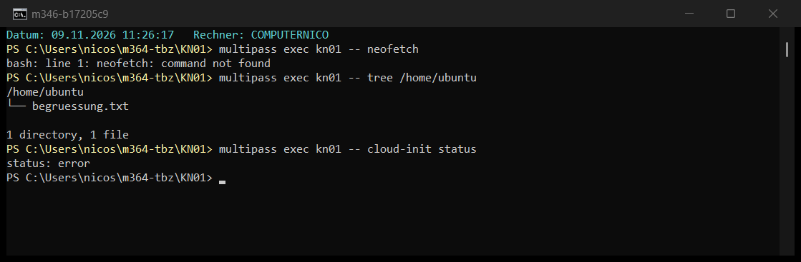

Im Log habe ich den Grund gefunden: `neofetch` gibt es in Ubuntu 26.04 nicht mehr (das Projekt wird nicht mehr weiterentwickelt). cloud-init konnte das Paket darum nicht installieren. `tree` wurde trotzdem installiert, das sieht man weiter oben im Log ("Setting up tree").

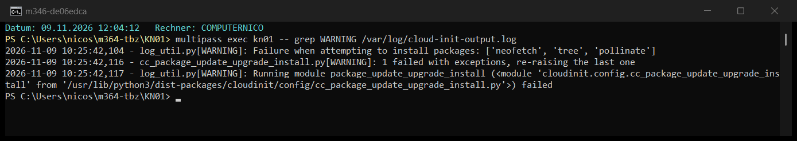

**begruessung.txt:**

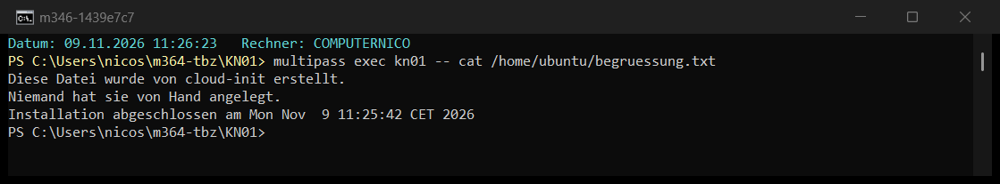

- Die ersten zwei Zeilen ("Diese Datei wurde von cloud-init erstellt." und "Niemand hat sie von Hand angelegt.") kommen aus `write_files`. Dort wird die Datei mit diesem Inhalt erstellt.
- Die letzte Zeile "Installation abgeschlossen am ..." kommt aus `runcmd`. Der `echo`-Befehl hängt sie mit `>>` am Schluss an. Weil `runcmd` erst am Ende läuft, steht sie zuunterst.

**cloud-init-Log** (`/var/log/cloud-init-output.log`, oberer Teil):

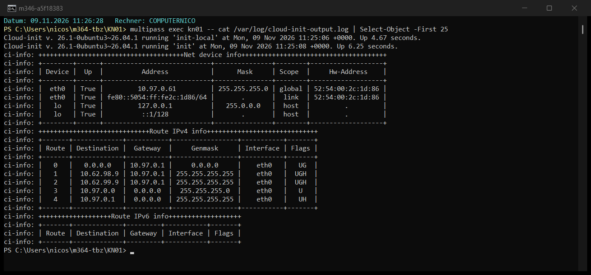

Danach habe ich die VM gelöscht: `multipass delete --purge kn01`

### C2) Eigene Konfiguration

Datei: [cloud-init-kn01.yaml](cloud-init-kn01.yaml)

Wegen dem Fehler aus C1 habe ich `neofetch` durch `fastfetch` ersetzt. Das ist der Nachfolger und macht das Gleiche.

```yaml
#cloud-config
users: # Liste der Benutzer, die beim ersten Start erstellt werden
  - default # Standardbenutzer ubuntu bleibt, sonst geht multipass shell nicht mehr
  - name: nico # mein eigener Benutzer
    sudo: ALL=(ALL) NOPASSWD:ALL # darf sudo ohne Passwort benutzen
    shell: /bin/bash # bash als Shell

package_update: true # Paketliste vor der Installation aktualisieren (apt update)

packages: # diese Pakete werden installiert
  - fastfetch # zeigt Systeminfos an, Ersatz für neofetch (gibt es in Ubuntu 26.04 nicht mehr)
  - tree # zeigt Ordner als Baum an (aus der Basis-Datei)
  - htop # mein zusätzliches Paket, Taskmanager fürs Terminal

write_files: # Dateien, die cloud-init erstellt
  - path: /home/ubuntu/begruessung.txt # Datei aus der Basis-Datei
    content: | # Inhalt der Datei, | heisst mehrere Zeilen
      Diese Datei wurde von cloud-init erstellt.
      Niemand hat sie von Hand angelegt.
  - path: /home/ubuntu/info-nico.txt # meine eigene Datei
    content: | # Inhalt der Datei
      Name: Nico Schult
      Schule: TBZ
      Modul: M346
      Diese VM wurde mit cloud-init aufgesetzt.

runcmd: # Befehle, die am Schluss vom ersten Start ausgeführt werden
  - echo "Installation abgeschlossen am $(date)" >> /home/ubuntu/begruessung.txt # Datum an die Datei anhängen
  - mkdir -p /home/nico/projekte # mein eigener Befehl: Ordner projekte erstellen
  - chown nico:nico /home/nico/projekte # Ordner gehört nico und nicht root
```

Die Syntax habe ich vor dem Start geprüft.

```powershell
multipass launch --name kn01v2 --cloud-init cloud-init-kn01.yaml 26.04
```

Diesmal zeigt `cloud-init status` **done**, es gab keine Fehler.

**1. Benutzer nico:** existiert, hat `/bin/bash` als Shell und darf sudo ohne Passwort (`sudo whoami` als nico gibt `root`).

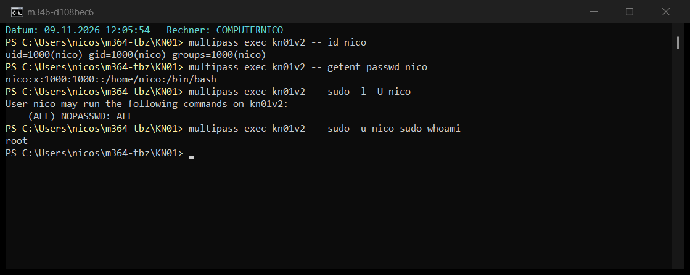

**2. Paket htop** (und fastfetch, tree) ist installiert:

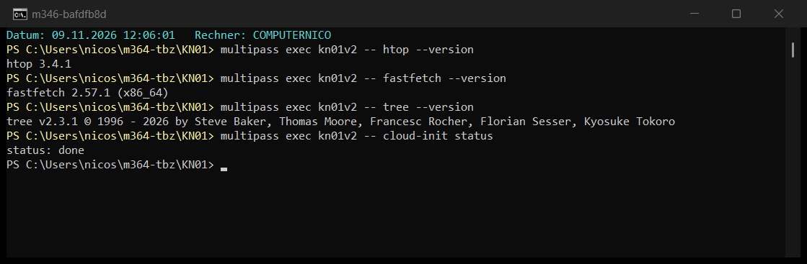

**3. Eigene Datei** `info-nico.txt` aus `write_files`:

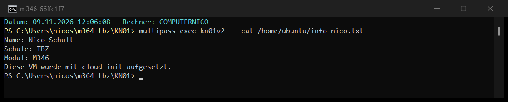

**4. Eigener Befehl:** Der Ordner `projekte` wurde von `runcmd` erstellt und gehört `nico`. Für `ls` braucht es `sudo`, weil `ubuntu` nicht in das Home von `nico` schauen darf.

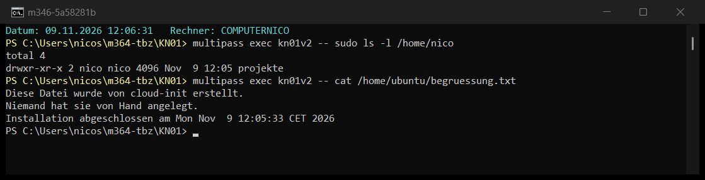

## D) Reflexion: von Hand vs. automatisiert

| Variante | Meine aktive Arbeitszeit |
|---|---|
| Von Hand (VM `manuell`) | _TODO_ |
| Mit cloud-init (ein Befehl) | _TODO_ |

_TODO: Reflexion kommt, wenn die Zeiten gemessen sind._
