# KN02: Cloud-Onboarding & SSH

## A) Learner Lab einrichten

Das Learner Lab läuft (grüner Punkt). Oben sieht man das Budget (`Used $0 of $50`) und die Zeit, die noch bleibt. Nach 4 Stunden stoppt das Lab automatisch. Die Instanzen werden dann nur gestoppt, nicht gelöscht, und man muss das Lab einfach neu starten.

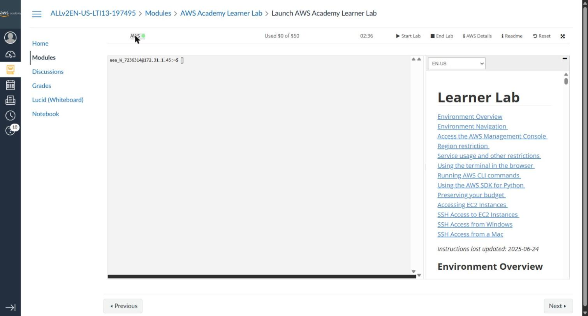

In der AWS-Konsole bei EC2. Oben rechts sieht man meinen Benutzer (`voclabs/user...`) und die Region USA (Nord-Virginia) = `us-east-1`.

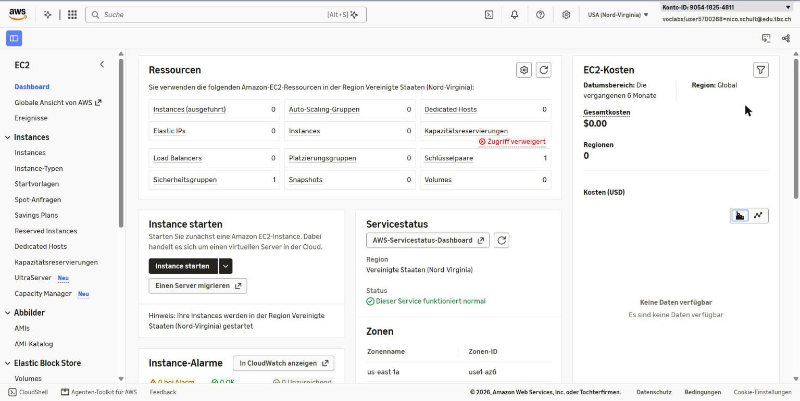

## B) SSH-Schlüssel verstehen

### B1) Instanz mit Schlüsselpaar

Ich habe in EC2 unter "Schlüsselpaare" zwei Keys erstellt: `nico1` und `nico2` (Standard: RSA, `.pem`). Die beiden .pem-Dateien habe ich aus dem Download-Ordner nach `C:\Users\nicos\.ssh\` verschoben. Unter Windows habe ich die Rechte so eingeschränkt, dass nur mein Benutzer die Datei lesen darf (das ist das Gleiche wie `chmod 400` unter Linux).

Danach habe ich die Instanz **KN02** gestartet: Ubuntu 26.04, t3.micro, Key Pair `nico1`. Für SSH braucht es eine Sicherheitsgruppe, die Port 22 erlaubt (`kn02-ssh`).

Instanz-Details mit öffentlicher IP (`54.166.188.162`):

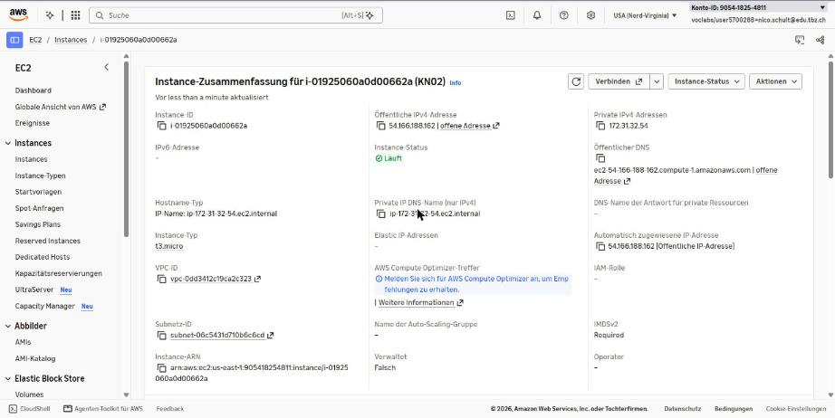

Weiter unten sieht man das Key Pair `nico1` und das Image (Ubuntu 26.04):

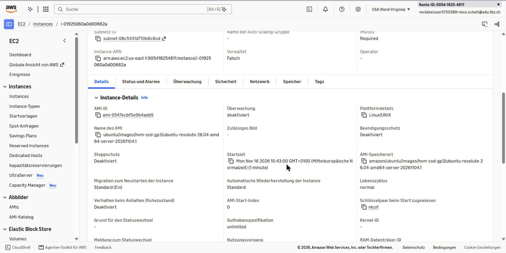

**Daten meiner Instanz:**

- Betriebssystem: Ubuntu 26.04.1 LTS
- CPUs: 2 (vCPUs)
- RAM: 1 GiB (in der VM sieht man 908 MiB, den Rest braucht der Kernel)
- Disk: 8 GB (in der VM sind 6.7G nutzbar, der Rest geht für Boot-Partitionen weg)

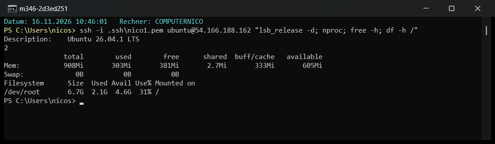

### B2) Das Experiment

Login mit dem **ersten** Schlüssel (`nico1`) → funktioniert:

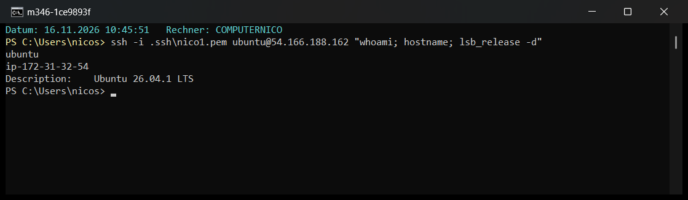

Login mit dem **zweiten** Schlüssel (`nico2`) → wird abgelehnt:

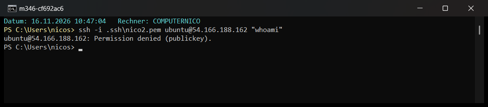

Danach habe ich aus beiden privaten Schlüsseln den öffentlichen Schlüssel herausgeholt (`ssh-keygen -y -f`) und mit `~/.ssh/authorized_keys` auf dem Server verglichen:

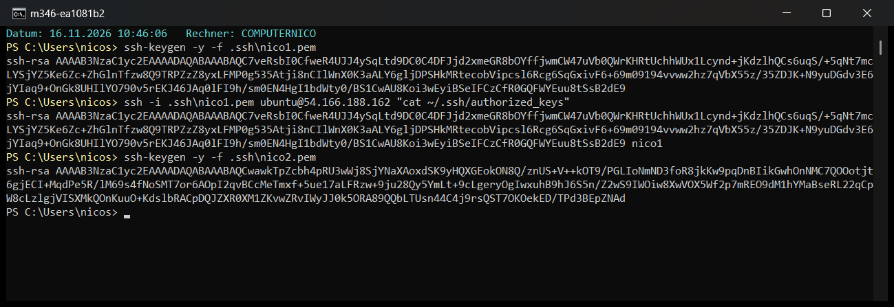

**Feststellung:** Der Public Key von `nico1` ist genau gleich wie der Eintrag in `authorized_keys` auf dem Server (nur hinten steht noch der Name `nico1`). Der Key von `nico2` ist komplett anders und steht dort nicht.

**Warum genau dieser Key dort liegt:** Beim Erstellen der Instanz habe ich `nico1` als Key Pair ausgewählt. AWS legt dann beim ersten Start den **öffentlichen** Teil von `nico1` in `authorized_keys` vom Benutzer `ubuntu`. Beim Login prüft der Server, ob mein privater Schlüssel zu einem öffentlichen Schlüssel in dieser Datei passt. Bei `nico1` passt es, bei `nico2` nicht, darum wird `nico2` abgelehnt.

Der private Schlüssel bleibt immer bei mir auf dem Laptop (`C:\Users\nicos\.ssh\`), auf dem Server liegt nur der öffentliche.

## C) Erste Instanz mit cloud-init & Template

### C1) cloud-init mit SSH-Key

Datei: [cloud-init-kn01.yaml](cloud-init-kn01.yaml)

Das ist meine Datei aus KN01. Ich habe nur beim Benutzer `nico` den öffentlichen Schlüssel von `nico1` ergänzt (`ssh_authorized_keys`, alles auf einer Zeile).

Dann habe ich die zweite Instanz **KN02-cloudinit** erstellt: Ubuntu 26.04, t3.micro, als Key Pair **nico2**, und die cloud-init-Datei als **User data**.

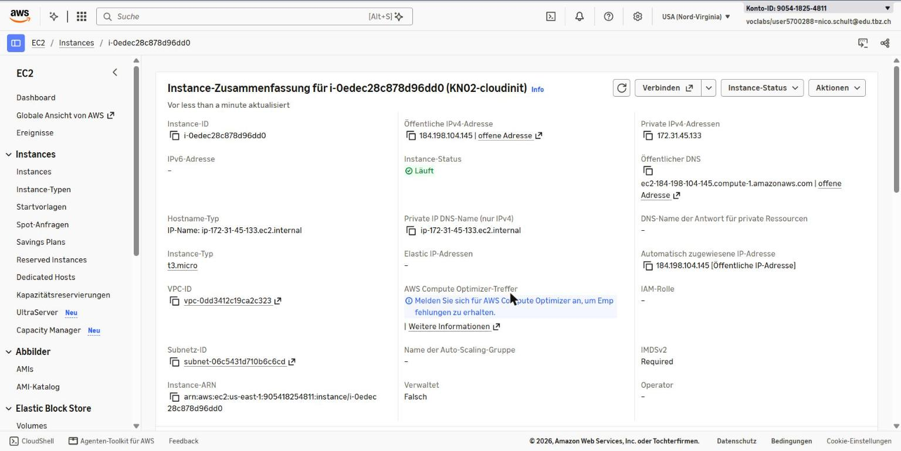

Jetzt gibt es zwei Schlüssel auf derselben Instanz: `nico2` über AWS für `ubuntu`, und `nico1` über cloud-init für `nico`.

**1. `ubuntu` mit `nico2`** → funktioniert:

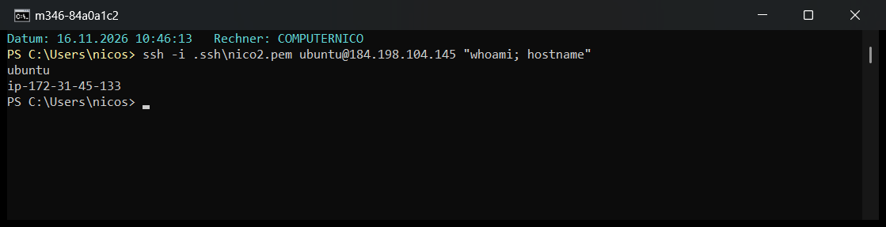

**2. `nico` mit `nico1`** → funktioniert:

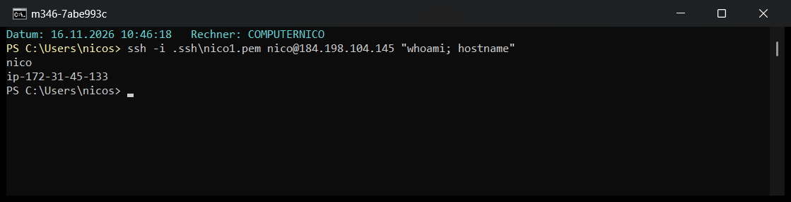

**3. `nico` mit `nico2`** → wird abgelehnt:

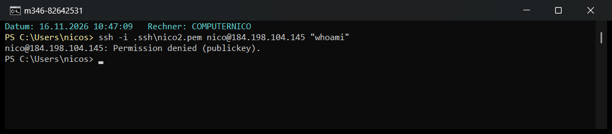

Die beiden Wege beeinflussen sich also nicht. Jeder Benutzer hat seine eigene `authorized_keys`-Datei. AWS schreibt den GUI-Key nur zu `ubuntu`, cloud-init schreibt meinen Key nur zu `nico`.

### C2) Nachweise in der Instanz

Eingeloggt als `nico` mit `nico1`. Meine Datei aus KN01 und das Paket `htop` sind auch in AWS da:

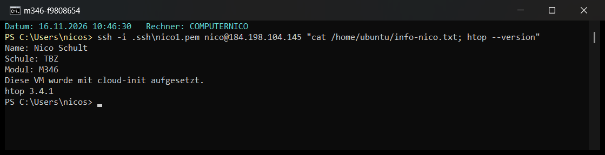

Das cloud-init-Log liegt am gleichen Ort wie in KN01 (`/var/log/cloud-init-output.log`). Ich brauche `sudo`, weil nur root die Datei lesen darf:

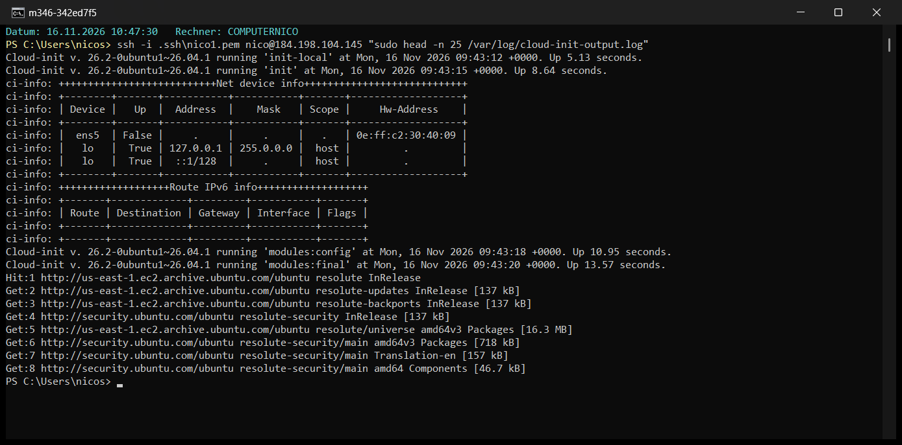

### C3) Mein Template

Datei: [cloud-init-template.yaml](cloud-init-template.yaml)

Das ist ab jetzt meine Vorlage für alle nächsten KNs. Darin sind zwei öffentliche Schlüssel: meiner (`nico1`) und der von meiner Lehrperson.

Die drei zusätzlichen Einstellungen:

- `ssh_pwauth: false`: Man kann sich per SSH nicht mehr mit einem Passwort einloggen, nur noch mit einem Schlüssel. So bringt es nichts, Passwörter durchzuprobieren.
- `disable_root: true`: Man kann sich nicht direkt als `root` einloggen. Wer Admin-Rechte braucht, loggt sich als normaler Benutzer ein und nimmt `sudo`.
- `package_update: true`: Beim ersten Start wird die Paketliste aktualisiert, damit gleich die neusten Pakete installiert werden.

### Reflexion

Ich habe die gleiche cloud-init-Datei zuerst lokal mit Multipass und dann in AWS benutzt, und beide Male kam das Gleiche heraus: gleicher Benutzer, gleiche Pakete, gleiche Dateien. Die Konfiguration ist also nicht an einen Anbieter gebunden, ich kann sie überall mitnehmen, wo cloud-init läuft (z. B. auch Azure oder Google Cloud). Das ist die Idee von Infrastructure as Code: Die Einrichtung steht als Text in einer Datei, die im Git liegt, eine Versionsgeschichte hat und jederzeit gleich wiederholt werden kann. Bei GUI-Klicks geht das nicht, weil die Klicks nirgends gespeichert werden. Man müsste sie jedes Mal von Hand und genau gleich wiederholen, und auf einer anderen Plattform sieht das GUI wieder ganz anders aus.
